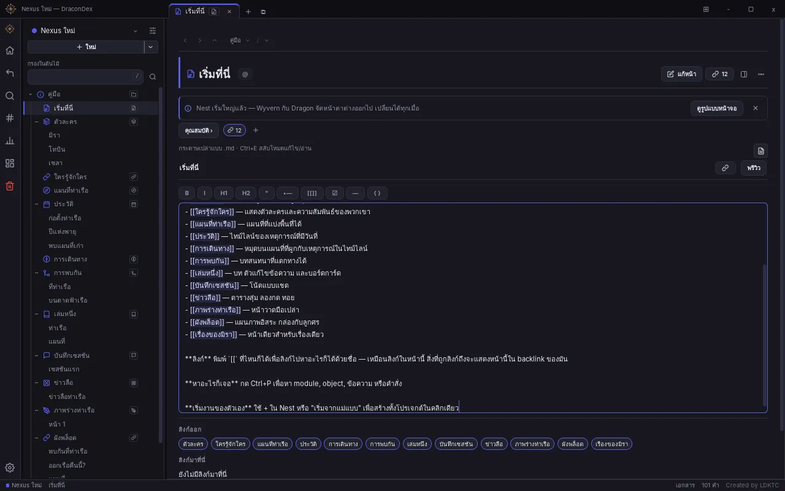

# DraconDex-RUT — DraconDex on Tauri

ทดลองรัน DraconDex บน **Tauri 2** แทน Electron โดย**ไม่ port โค้ดแอปเลย**:
renderer, `preload.js`, `main.js` และ db layer ทั้งหมดเป็นของ
[DraconDex-EXE](https://github.com/ZYDRAXYL/DraconDex-EXE) ตัวจริง



## ทำงานยังไง

```
Tauri (Rust, src-tauri/)                 Node sidecar (sidecar/server.cjs)
─────────────────────────                ──────────────────────────────────
หน้าต่าง / dialog / เปิด URL / ถังขยะ  ⇄   electron/main.js ของ EXE (443 IPC handlers)
         stdio JSON lines                    ใต้ `electron` module ปลอม
                                           + HTTP 127.0.0.1:<สุ่ม> เสิร์ฟ renderer
WebView ─── fetch /__ddx/ipc (มี token) ──→ handler ตัวเดียวกับ Electron
```

- **sidecar** โหลด `main.js` ของ EXE โดยแทน `require('electron')` ด้วย stub
  (แนวเดียวกับ `run-dracondex/web-driver.mjs` ใน EXE) แล้วส่งงานฝั่ง native
  (`BrowserWindow`, `dialog`, `shell`, `screen`) ให้ Rust ผ่าน stdio
- **renderer** ได้ `preload.js` ตัวจริง แต่ `ipcRenderer.invoke` วิ่งผ่าน `fetch`
  และ `ipcRenderer.on` วิ่งผ่าน `EventSource`
- **token** ของ IPC ฝังเข้าหน้าเว็บผ่าน `initialization_script` ของ Tauri เท่านั้น
  ไม่เคยส่งทาง HTTP · server รับเฉพาะ `Host: 127.0.0.1:<port>` (กัน DNS rebinding)
  · เสิร์ฟไฟล์ได้แค่ `electron/` กับ `src/` ของ EXE
- หน้าเว็บ**ไม่มีสิทธิ์เรียก Tauri command ใดๆ** (`capabilities/default.json` ว่าง)

## โลโก้

Tauri ใช้ **Star compass สีน้ำเงินเข้ม `#14213D` + ส้ม `#F28C28`** เพื่อแยกจาก
Electron ที่ใช้ `DraconDex_Color` (สีรุ้ง/เทา)

- `assets/DraconDex_Tauri.svg` แปลงเป็นเวกเตอร์จาก `assets/brand/DraconDex_BlackIn.png`
  ของ SDB (เปลี่ยนสี 2 สีแล้ว trace ด้วย vtracer)
- `assets/DraconDex_Tauri.png` คือไฟล์ที่ render จาก SVG ข้างบน ใช้สร้างไอคอนทั้งชุด (`npm run icons`)
- ใน UI ตัว sidecar เสิร์ฟ SVG นี้แทน `DraconDex_Color.webp` / `.png` จึงไม่ต้องแก้ EXE

## รัน

ต้องมี: Rust, Node.js 20+ ใน PATH, [ของที่ Tauri ต้องใช้บน OS นั้น](https://tauri.app/start/prerequisites/)
และ clone **DraconDex-EXE ไว้ข้างๆ repo นี้**

```bash
# ครั้งแรก
(cd ../DraconDex-EXE && npm install --ignore-scripts)   # ใช้แค่ node-sqlite3-wasm
npm install

npm run dev      # tauri dev
npm test         # smoke test ของ sidecar (ไม่ใช้ Tauri, ใช้ Chromium ของ Playwright)
```

| env | ค่าเริ่มต้น |
|---|---|
| `DRACONDEX_EXE` | `../DraconDex-EXE` |
| `DRACONDEX_NODE` | `node` |
| `DRACONDEX_SIDECAR` | `sidecar/server.cjs` |

ข้อมูลเก็บที่ app data dir ของ Tauri (`com.dracondex.rut/novel-manager-data`) แยกจาก
ข้อมูลของ Electron

## ยังไม่ทำ (ตั้งใจ)

- **build สำหรับแจก** — ตอนนี้ยังหา Node และ EXE จาก path ของเครื่อง dev ถ้าจะแจก
  ต้อง bundle Node เป็น `externalBin` และใส่ `electron/` + `src/` + `node-sqlite3-wasm` เป็น resources
- **safeStorage** — เข้ารหัส credential ไม่ได้ จึงเก็บ Drive/Sync token เป็น plaintext
  (`secret-store.js` จะ warn) ต่อ keyring ฝั่ง Rust ได้ทีหลัง
- **ปลั๊กอิน** (window และ `<webview>` panel) ถูกปฏิเสธ เพราะ WebView ของ Tauri ไม่มี
  `<webview>` tag และไม่มี preload แยก
- **printToPDF**, **`ddx-file://`** (รูปจะใช้ fallback `importdock:readFiles` แทน), **ลากไฟล์มาวาง**
  (ใช้ `webUtils.getPathForFile` ไม่ได้)
- **WebKit (Linux/macOS)**: `settings.js` ชดเชย `zoom` ของ body ด้วย `vw/vh` ซึ่งถูกเฉพาะบน
  Chromium ตัว bridge จึงยกเลิกการชดเชยนี้เมื่อไม่ใช่ Chromium · บน Windows (WebView2)
  ไม่ต้องทำ
